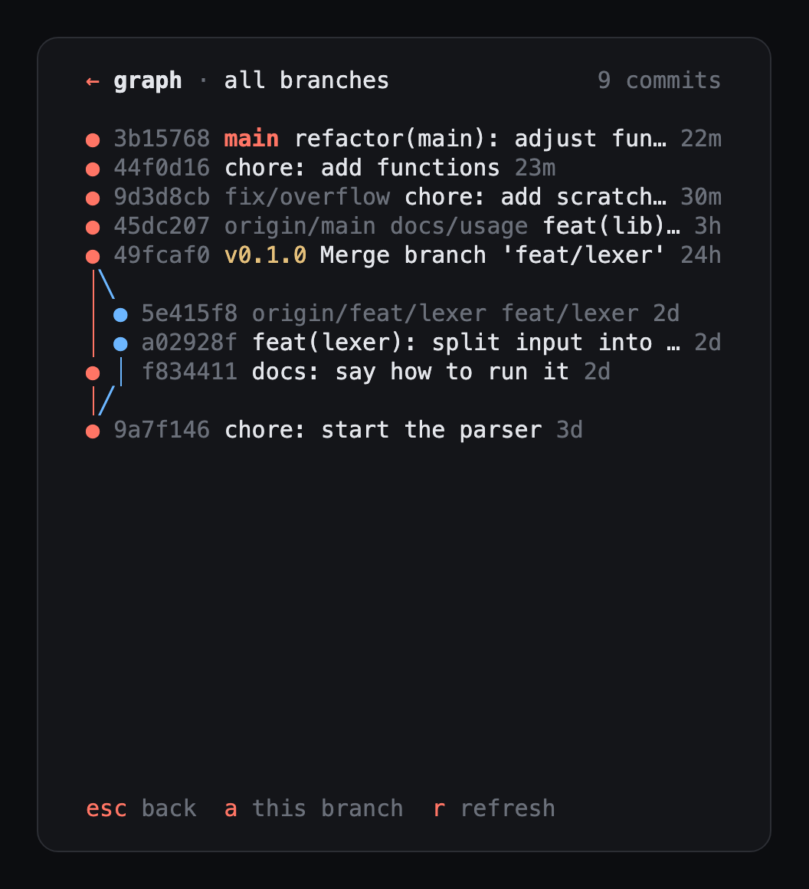
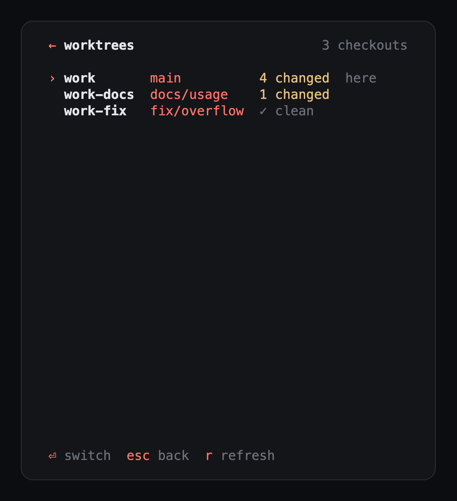
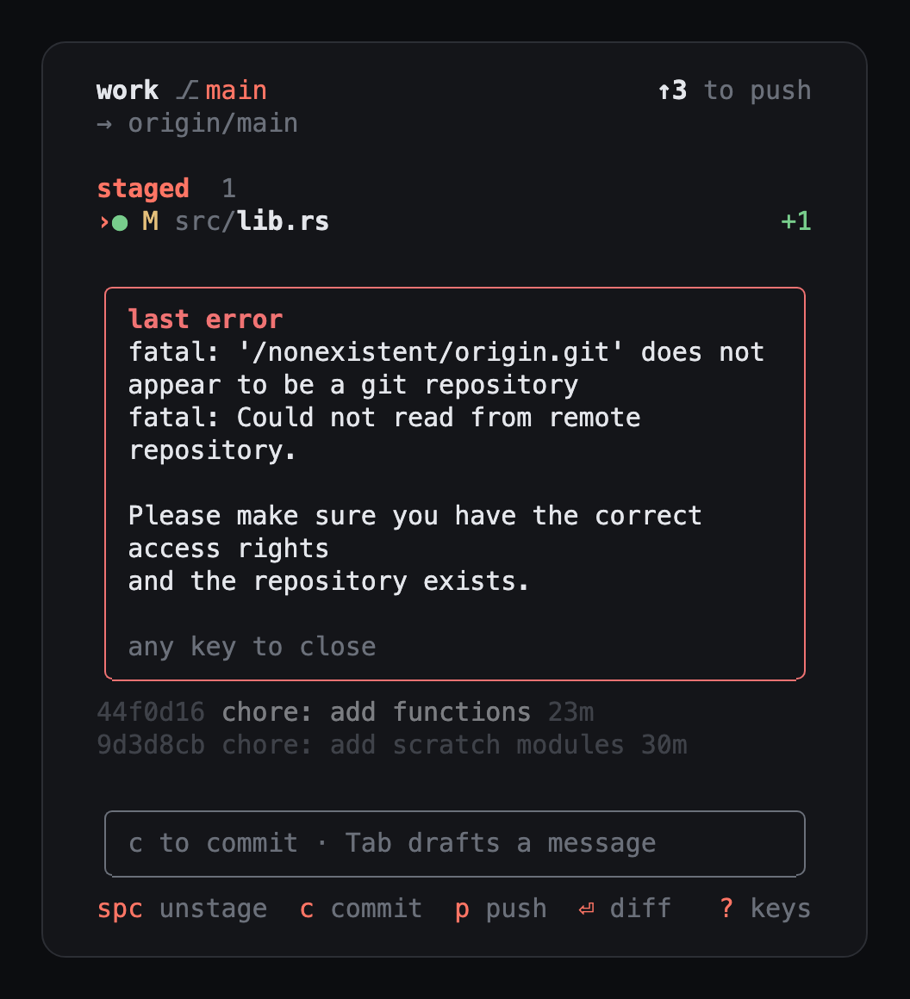

# rex-git

A git side pane for [Rex](https://www.superlogical.com/rex), styled after
[Axel](https://axel.md). It shows the branch and how far it is from its upstream, the
changed files, and recent commits. You can read diffs, stage files, write a commit
message (or have Claude draft it), commit, push and pull, all from a narrow pane next
to your work.

<p>
  
  
  
</p>

With Axel, it also opens by itself in every thread window, on that thread's workspace,
and marks the files the thread's agents changed.

## Install

With Homebrew:

```sh
brew install owlnai/tap/rex-git
```

Or with the installer, on macOS or Linux:

```sh
curl -LsSf https://github.com/owlnai/rex-git/releases/latest/download/rex-git-installer.sh | sh
```

Or from source, with [Rust](https://rustup.rs): `cargo install --git https://github.com/owlnai/rex-git`.

Open it next to the pane you're in:

```sh
rex split --split=right --ratio 30 --label git --focus=false -- rex-git
```

`rex-git [DIR]` opens on `DIR`, or on the current directory. Press `?` inside for every
key.

**Drafting commit messages** uses the [Claude Code](https://claude.com/claude-code) CLI,
`claude`, with Haiku. Without it, everything else works.

## A tour

### Files


The header has the folder and branch, how far the branch is from its upstream, and
when it last fetched. Click the sync state (`↑3 to push`, `✓ synced`…) to sync: it
publishes a new branch, or fetches, pulls `--ff-only` and pushes.

Files are grouped as staged, changed and untracked, with the lines each one adds and
removes. `Space` or a click on `●` stages and unstages, `a` and `u` stage and unstage
everything. Files a merge or rebase left in conflict come first, under `conflicts`;
`Space` marks one resolved once its `<<<<<<<` markers are gone. Below them are the last
three commits, the older ones fading out.

The bottom line shows the keys that fit what you're doing, and clicking one presses it.

### Diffs


`Enter` or a click opens a file's diff. Added lines are on green, removed lines on red,
and within an edited line the words that changed are brighter. Instead of `@@` hunk
headers, every line has its number, and the lines left out between changes show as
`⋯ 3 unchanged lines · fn f26()`, with the function they're in when git can tell.

`n` and `N` move between files, `s` stages, and `e` shows more context (3, 10 or 30
lines, as the hint says). `Esc` goes back.

### Committing


`c` opens the commit box, which takes the list's place while you write, with the staged
count and the subject's length on its border (yellow past 50, red past 72). `Enter`
commits, `Shift+Enter` adds a line, `Ctrl+E` opens the message in `$EDITOR`, and `↑`
`↓` and the wheel scroll a long message.

`Tab` asks Claude to draft the message, or to finish the one you started, keeping your
words. When something is staged and the box is empty, `c` drafts one for you. With
nothing staged, `Enter` asks first: `Enter` again stages everything and commits, `s`
goes back to pick files.

### Commit graph



`g` shows the current branch's history with its lanes, branches and tags. `a` switches
to every branch and tag, `r` refreshes, and `Esc` or `g` goes back.

### Worktrees



In a linked worktree, the header says which repo it belongs to (`worktree of work`).
`w` lists every checkout of the repo with its branch and how many files it changed, and
`Enter` or a click switches rex-git to it. A message you were writing waits in its
worktree until you come back.

### Errors



Messages like `pushed 2 commits` fade after a few seconds. An error stays in place of
the keys until your next key or click, and shows git's `fatal:` line rather than its
closing advice. When there's more to it, `! more` says so, and `!` shows the last error
in full. The fetch every 3 minutes fails quietly, as when you're offline.

## Keys

Press `?` inside for this list.

| Key | |
|---|---|
| `↑` `↓` `j` `k` | Move |
| `Enter`, click | Show the file's diff |
| `Space`, click `●` | Stage or unstage the file |
| `a` / `u` | Stage everything / unstage everything |
| `c` | Write the commit message (drafted for you when something is staged) |
| `Tab` | Draft a commit message with Claude |
| `g` | Show the commit graph |
| `w` | Switch to another worktree |
| Click `✓ synced`, `↑2 to push`… | Sync: publish the branch, or fetch, pull `--ff-only` and push |
| `p` / `P` / `f` | Push / pull `--ff-only` / fetch (it also fetches every 3 minutes) |
| `t` | Stage the files from the agents' latest turn (with Axel) |
| `!` | Show the last error in full |
| `q` | Quit |

## With Axel

[Axel](https://axel.md) runs coding agents in Rex, one window per thread. rex-git adds:

- **A pane in every thread window.** The watcher in [`axel/`](axel) opens rex-git beside
  the conversation in each new Axel thread window whose workspace is a git repository,
  on that thread's worktree or project. Close the pane and it stays closed for that
  window. Install it once:

  ```sh
  curl -LsSf https://raw.githubusercontent.com/owlnai/rex-git/main/axel/install.sh | sh
  ```

  It installs rex-git too if it's missing. On macOS it starts the watcher now and at
  every login with a LaunchAgent; elsewhere, keep
  `rex do ~/.config/rex/axel-git.lua --all` running. Run it again with `--uninstall`
  (`sh -s -- --uninstall` when piping) to remove it.

  I will try to add Linux and Windows support future, but right now I'm only using Mac.
  Feel free to experiment and submit a PR if you find a way!

- **What the agents changed.** The header names the thread's agents, and files they
  changed are marked: `◆` in their latest turn that changed files, `◇` in an earlier one.
  `t` stages the latest turn's files. rex-git finds the thread working in its directory
  by itself, or takes one with `--thread ID`.

- **Commit messages that know why.** The draft is written with the thread's intent, so
  it can say what the change was for.

To know which turns changed files, rex-git reads Axel's database (`~/.axel/axel.db`,
read-only) and then asks `axel thread diff --stat` for each of those turns. The database
isn't a public interface, so a new Axel version may change it. If it does, rex-git falls
back to the latest turn only.

## Notes

- Git runs with prompts turned off (`GIT_TERMINAL_PROMPT=0`, and SSH in batch mode), so a
  push that needs a password fails with a message instead of taking over the pane. Your
  own `core.sshCommand`, `GIT_SSH_COMMAND` or `GIT_SSH` is kept. Signed commits work when
  your GPG pinentry is a GUI one, such as `pinentry-mac`.
- The pane keeps its Rex title up to date, for example `git · main ↑2`.
- Set `REX_GIT_DEBUG=/path/to/log` to log every input event, which helps when a key
  doesn't do what you expect.

## License

[MIT](LICENSE)
