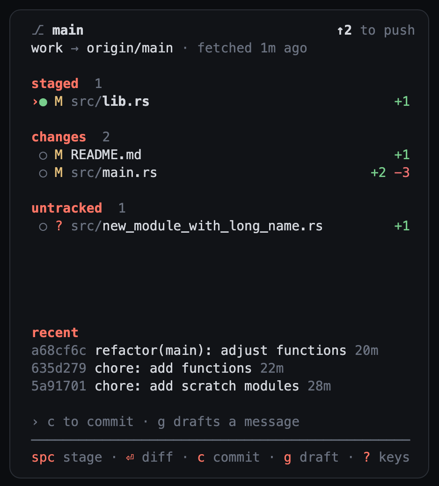
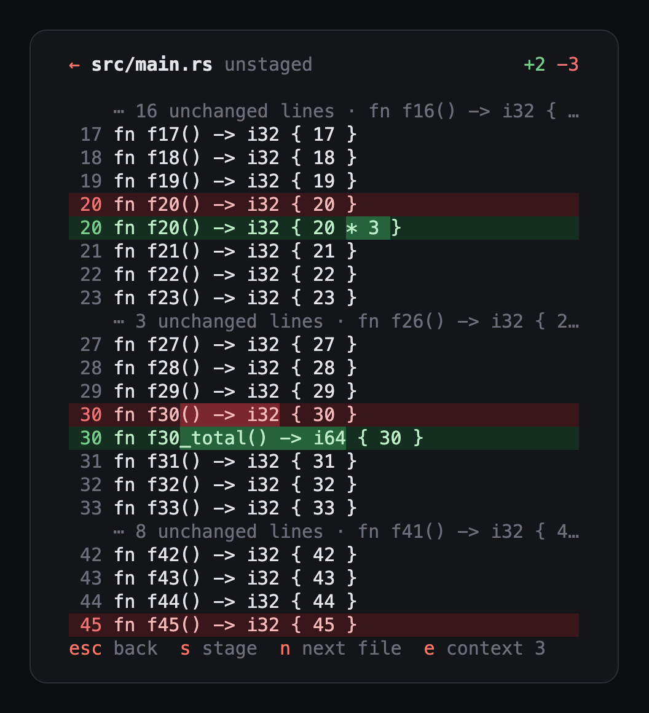
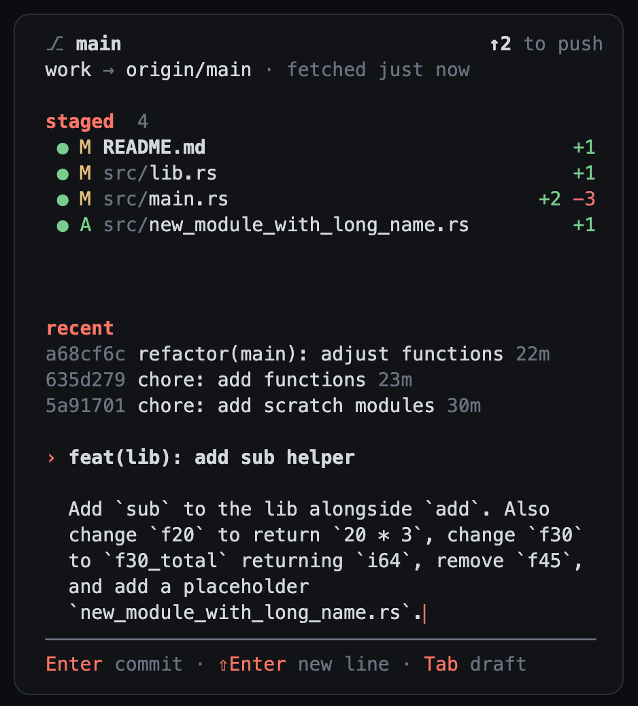

# rex-git

A git side pane for [Rex](https://www.superlogical.com/rex), styled after
[Axel](https://axel.md). It shows the branch and how far it is from its upstream, the
changed files, and recent commits. You can read diffs, stage files, write a commit
message (or have Claude draft it), commit, push and pull, all from a narrow pane next
to your work.

<p>
  
  
  
</p>

With Axel, it also opens by itself in every thread window, on that thread's workspace,
and marks the files the thread's agents changed.

## Install

You need [Rust](https://rustup.rs), git, and Rex.

```sh
cargo install --git https://github.com/owlnai/rex-git
```

Open it next to the pane you're in:

```sh
rex split --split=right --ratio 30 --label git --focus=false -- rex-git
```

`rex-git [DIR]` opens on `DIR`, or on the current directory. Press `?` inside for every
key.

**Drafting commit messages** uses the [Claude Code](https://claude.com/claude-code) CLI,
`claude`, with Haiku. Without it, everything else works.

## Keys

| Key | |
|---|---|
| `↑` `↓` `j` `k` | Move |
| `Enter`, click | Show the file's diff |
| `Space`, click `●` | Stage or unstage the file |
| `a` / `u` | Stage everything / unstage everything |
| `c` | Write the commit message (drafted for you when something is staged) |
| `g` | Draft a commit message with Claude |
| `p` / `P` / `f` | Push / pull `--ff-only` / fetch (it also fetches every 3 minutes) |
| `t` | Stage the files from the agents' latest turn (with Axel) |
| `q` | Quit |

In the commit box, `Enter` commits, `Shift+Enter` adds a line, and `Tab` asks Claude to
draft the message, or to finish the one you started, keeping your words. In a diff, `n`
and `N` move between files, `s` stages, `e` shows more context, and `Esc` goes back.

## Diffs

Added lines are on green, removed lines on red, and within an edited line the words that
changed are brighter. Instead of `@@` hunk headers, every line has its number, and the
lines left out between changes show as `⋯ 17 unchanged lines · fn parse()`, with the
function they're in when git can tell.

## With Axel

[Axel](https://axel.md) runs coding agents in Rex, one window per thread. rex-git adds:

- **A pane in every thread window.** The watcher in [`axel/`](axel) opens rex-git beside
  the conversation in each new Axel thread window whose workspace is a git repository,
  on that thread's worktree or project. Close the pane and it stays closed for that
  window. Install it once:

  ```sh
  git clone https://github.com/owlnai/rex-git && cd rex-git
  cargo install --path .
  axel/install.sh
  ```

  On macOS, `install.sh` starts it now and at every login with a LaunchAgent. Elsewhere,
  keep `rex do ~/.config/rex/axel-git.lua --all` running. `axel/install.sh --uninstall`
  removes it.

  I will try to add Linux and Windows support future, but right now I'm only using Mac.
  Feel free to experiment and submit a PR if you find a way!

- **What the agents changed.** The header names the thread's agents, and files they
  changed are marked: `◆` in their latest turn that changed files, `◇` in an earlier one.
  `t` stages the latest turn's files. rex-git finds the thread working in its directory
  by itself, or takes one with `--thread ID`.

- **Commit messages that know why.** The draft is written with the thread's intent, so
  it can say what the change was for.

To know which turns changed files, rex-git reads Axel's database (`~/.axel/axel.db`,
read-only) and then asks `axel thread diff --stat` for each of those turns. The database
isn't a public interface, so a new Axel version may change it. If it does, rex-git falls
back to the latest turn only.

## Notes

- Git runs with prompts turned off (`GIT_TERMINAL_PROMPT=0`, and SSH in batch mode), so a
  push that needs a password fails with a message instead of taking over the pane. Signed
  commits work when your GPG pinentry is a GUI one, such as `pinentry-mac`.
- The pane keeps its Rex title up to date, for example `git · main ↑2`.
- Set `REX_GIT_DEBUG=/path/to/log` to log every input event, which helps when a key
  doesn't do what you expect.

## License

[MIT](LICENSE)
